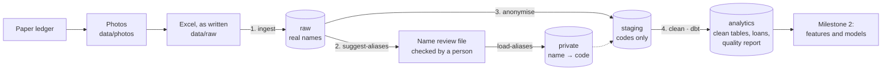

# Milestone 1 report — the data pipeline

*Chama Loan Default Prediction · status as of 8 October 2026*

Milestone 1 (M1) turns a Chama's handwritten loan ledger into clean,
anonymised, checked data that a model can learn from. This report explains
what was built, how it works, the decisions behind it and the tools used, and
lists every command needed to run it. The decisions are recorded in full in
[decisions.md](decisions.md); the column-by-column reference is
[data_dictionary.md](data_dictionary.md).

---

## 1. Summary

| | |
| --- | --- |
| **Built** | A five-step pipeline, run with one command: `python -m chama.pipeline all` |
| **Input** | Photos of the Chama B ledger (149 pages, early 2014 – April 2026), typed into Excel exactly as written |
| **Output** | The `analytics` database schema: typed ledger tables, one row per loan with its outcome, and a data quality report, holding member codes only and no names |
| **Data so far** | 2014 (in full) and 2015 (extracted, name review pending): 24 pages, 308 member lines, 34 listed loans |
| **Checks** | 45 Python tests, 33 dbt data tests, 3 dbt unit tests; the last full run passed with 1 expected warning |
| **Issues** | #5, #6, #8, #9, #10, #11, #12, #13 built; #7 (accuracy check of the 2014 test batch) waits for the comparison with the paper |

---

## 2. The problem M1 solves

The Chama keeps its loans in a paper ledger. Each page is one monthly meeting:
a row per member with the balance before, repayment, interest, balance after
and the month the loan is due, followed by the loans given that day, totals
and notes. To predict loan default, that record has to become data. Four
things make this hard:

1. **Handwriting.** Amounts are written as `40,000`, `46 000`, `59,000/=`,
   `Ksh. 43,571` or `5500 + 776`; dates as `8/6/14`, `9th Feb` or not at all;
   due months as `Nov. 2014`, `11/14`, `May 15` or just `Aug`.
2. **No loan numbers.** A loan exists only as a balance carried from page to
   page, sometimes with top-ups, alongside short emergency loans.
3. **Names.** The ledger names members, spelled differently from page to page.
   The data is used with the officials' written permission and must be
   protected.
4. **Trust.** Every number used later must be traceable back to its photo, and
   problems must be visible rather than silently fixed.

---

## 3. How the pipeline works



`python -m chama.pipeline all` runs steps 0–4 in order (step 0 creates the
database schemas). Each step can also be run on its own.

| Step | Command | What it does | Code |
| --- | --- | --- | --- |
| 0 | (part of `all`) | Creates the four schemas and the private tables if missing | `sql/01_schemas.sql`, `db.py` |
| 1 | `ingest` | Copies every yearly Excel file into the `raw` schema as text, exactly as typed, and reports missing or unexpected columns | `ingestion/` |
| 2 | `suggest-aliases`, `load-aliases` | Groups spellings of the same member for a person to review; loads the reviewed list | `anonymisation/aliases.py` |
| 3 | `anonymise` | Copies raw to `staging` with member codes instead of names and no free text, then checks that no name is left | `anonymisation/anonymise.py` |
| 4 | `clean` | Runs the dbt project: typed tables, loans rebuilt from the ledger lines, data checks, quality report | `transform/`, `cleaning/`, `validation/` |

### Step 1 — Ingest (issues #5, #6)

**Approach.** Photos are typed into an Excel template whose four sheets mirror
the ledger: **Statements** (one row per member line), **Meetings** (one row
per page), **NewLoans** (one row per loan given) and **Attendance** (from the
minutes, when available). Every row carries `source_photo` and an `unclear`
flag. Values are typed exactly as written: no corrections, no totals. The
loader reads every value as text, records the Excel row number, reports
missing or unexpected columns before loading, and replaces that Chama's rows in
`raw` so it can be re-run safely.

**Application.** Raw data stays faithful to the ledger, so any later value can
be checked against the paper. The sheet layout is defined once
(`raw_format.py`) and used by the template, the loader and the checks.

### Step 2 — Name matching (issue #8)

**Approach.** Every spelling is normalised (lower case, no dots or extra
spaces) and compared with the others. The score allows for initials
(`J. Kamau`), swapped order (`Kamau John`), spelling slips (`Wanjiku` /
`Wanjiko`) and a missing name. Spellings that score at least 0.85 are
suggested as one member; the fullest spelling becomes the member's name. The
suggestions go into a review file, `data/interim/aliases_<chama>.csv`, with a
status (`check`, `new`, `reviewed`), the score, and `similar_to`, which points
out close names that were *not* merged. A person checks the file in Excel and
runs `load-aliases`; nothing is merged without that review.

**Application.** One person must have one identity across the years, or their
loan history splits in two. In 2014, 22 spellings became 14 members.

### Step 3 — Anonymisation (issue #9)

**Approach.** Each reviewed member name becomes a code such as `M-3f9a1c2b`,
using HMAC-SHA256 with a secret key kept in `.env`. The same name always gives
the same code, but the name cannot be recovered without the key, and the
Chama id is part of the input so namesakes in two Chamas get different codes.
`staging` receives only structured columns plus `member_code`. Free text
(remarks, notes, the meeting host) stays in `raw`. Before saving, every
staging column is scanned for words from members' names, and the step stops if
one is found or if any spelling has not been reviewed.

**Application.** From `staging` onwards, including the models and the future
dashboard, nothing holds a name. This is the project's privacy guarantee.

### Step 4 — Clean, link loans, check (issues #10, #11, #12)

This step is a dbt project in `transform/` that reads `staging` and builds the
`analytics` schema.

**Cleaning (#10).** Amounts, dates, interest and due months are parsed into
numbers and dates:

- Amounts: commas, spaces, `/=` and `Ksh` are dropped, `300k` is 300,000,
  sums such as `5500 + 776` are added, and `-` or `nil` mean 0.
- Dates are day-first (`8/6/14` is 8 June 2014).
- A due month written without a year (`Aug`) is the next such month after the
  meeting.
- Interest written with `%`, or as a number up to 20, is a rate; a larger
  number is an amount.

Pages without a date get one from the previous page's "next meeting" note, or
are counted one month at a time from the nearest dated page; `date_source`
records which. Anything that cannot be read is kept, with the reason in an
`issues` column.

**Linking loans (#11).** A ledger line continues an earlier line of the same
member (up to three pages back) when its balance before matches that line's
closing balance, or that balance plus a loan listed at that meeting (a
top-up), within 10%. The nearest page wins, then the closest balance, and both
lines must choose each other. Unmatched lines start a new loan. Each loan then
gets:

- when it was given, and how that was found (`issue_source`);
- its due month (from the ledger; the `loan_term_days` rule only fills gaps);
- what was repaid, and the month it was cleared;
- the balance outstanding at the due month;
- a status: `repaid_on_time`, `repaid_late`, `overdue`, `open`, or
  `lost_track`.

**Checks and report (#12).** dbt tests check every model. Structural problems
(duplicate ids, a page with no month, an unknown status, a balance line not
tied to a loan) stop the pipeline. Ledger inconsistencies (a balance not
carried forward exactly, a balance that grows too much) only warn, because
the data must stay as written. Three dbt unit tests run the parsing, dating
and linking rules on made-up rows. On success, a quality report (counts per
Chama and year) is printed and saved to `data/processed/quality_report.csv`.

**Application.** `analytics.loans` is the loan-level table from which
Milestone 2 defines default; the quality report shows how far the data can be
trusted.

### One command (issue #13)

`all` runs every step and works on an empty database. The review files are
the lasting record of the name review: `load-aliases` marks their rows
`reviewed`, and `all` restores those rows into a rebuilt database (never
unreviewed suggestions). When new spellings appear, `all` writes the review
file and stops with instructions. This was tested by wiping a scratch database
and refilling it with the single command.

---

## 4. Technology stack

The project follows the DataTalksClub **Data Engineering Zoomcamp** stack,
except where a tool does not suit private, small, batch data on one computer.

| Tool | Role in this project | Zoomcamp |
| --- | --- | --- |
| **Python 3.11** (conda env `chama`) | Pipeline code: ingest, name matching, anonymisation, report | Course uses uv for environments; this project uses conda by choice |
| **PostgreSQL 16 in Docker Compose** | The database with the four layers; one `docker compose up -d` | Same |
| **SQLAlchemy + psycopg2, pandas, openpyxl** | Reading Excel, writing and reading Postgres | Same family of tools |
| **click** | The command line: `python -m chama.pipeline <step>` | Same |
| **dbt (dbt-postgres)** | Cleaning, loan linking, data tests, unit tests (`transform/`) | Same |
| **pytest, ruff** | Python tests and linting | — |
| **HMAC-SHA256** (Python standard library) | Member codes | Project-specific |
| **difflib** (Python standard library) | Name similarity, with no extra dependency | Project-specific |
| **Git + GitHub** | Version control, issues and milestones | Same |
| **PlantUML / Mermaid** | Diagrams in `docs/diagrams/` and this report | — |

**Course tools not used, and why:**

- **Cloud storage and warehouse (GCS, BigQuery, Terraform).** The data names
  real people and is used with the officials' permission, so it never leaves
  this computer (D-001).
- **Kestra (orchestration).** Runs are occasional, on one computer, with a
  human review in the middle. A scheduler adds a server without removing that
  step. Deferred to Milestone 3, where a Kestra flow can simply call
  `python -m chama.pipeline all` (D-011).
- **Spark and Kafka.** The data is a few thousand rows of monthly batch
  records, so distributed or streaming processing is not needed.
- **pgAdmin.** Not added yet; the database is inspected with `psql` (see the
  commands below). It can be added to `docker-compose.yml` when useful.
- **pandera.** Planned for #12, replaced by dbt tests so one tool covers both
  transformations and checks (D-009). It is still listed in `pyproject.toml`.

---

## 5. Design decisions

| ID | Decision | Why | Applied in |
| --- | --- | --- | --- |
| D-001 | Anonymise inside the pipeline, not by hand | Raw data stays faithful to the ledger; protection becomes a visible, tested step | `pseudonymise.py`, `anonymise.py` |
| D-002 | Four database layers: `raw`, `private`, `staging`, `analytics` | Separates real names (raw, private) from everything that analyses data | `sql/01_schemas.sql` |
| D-003 | Branch per issue, pull requests | First git workflow; replaced by D-007 | — |
| D-004 | One Excel file per Chama per year | Small enough to check against the paper in one sitting; a fix to one year does not touch others | `data/raw/<chama>/<year>.xlsx`, `read_folder()` |
| D-005 | Photos named by page order (`chama_b_p001.jpg`) with a manifest | Pages were photographed in order; the date is data, read from the page | `data/photos/`, page numbers in dbt |
| D-006 | Excel layout mirrors the ledger's meeting statements | Raw data should look like the source; splitting into loans is done in tested code | `raw_format.py`, template |
| D-007 | One long-lived branch per milestone plus `housekeeping` | The branch name says what the work belongs to | [git_workflow.md](git_workflow.md) |
| D-008 | Free text stays in `raw`; staging gets structured columns and codes only | Free text mentions people, including non-members; no name list can clean it reliably | `anonymise.py` |
| D-009 | dbt builds the analytics layer and runs the checks | Course tool; one tool for transformations and data tests; SQL never sees names | `transform/` |
| D-010 | Loans rebuilt by chaining ledger lines on balance | No loan numbers exist; balance continuity is how a person reads the ledger | `loan_lines.sql`, `loans.sql` |
| D-011 | One command (`all`); Kestra deferred | Occasional runs with a human review in the middle | `pipeline.py` |

D-007's write-up still mentions pull requests. In practice, branches are
merged into `main` from the terminal with `git merge --no-ff`, as described in
[git_workflow.md](git_workflow.md).

Smaller choices made along the way, and their reasons:

- **Flag, never drop.** Unreadable values become empty, with the reason in
  `issues`, and the row stays. The issue for #10 asked for this, and it keeps
  the counts honest.
- **Planned stops, not crashes.** A step that cannot continue (unreviewed
  names, a name found in staging, a failed dbt test) stops with a short
  message saying what to do, instead of a Python traceback.
- **Written due month first.** In 2014 the ledger's due month is about 15
  months after a normal loan is given, not the 12 implied by
  `loan_term_days: 365`. The ledger's month is what the Chama agreed for that
  loan, so it wins; the rule only fills gaps. This is still to be confirmed
  with the Chama.
- **Linking tolerance of 10%, up to three pages back.** This allows for
  interest added in a missed month, small misreadings and a member missing up
  to two meetings, while keeping a member's separate loans apart.
- **Emergency loans** (usually 5%, repaid at the next meeting) are identified
  from the new-loans list, the rate, or a loan repaid with a premium at its
  first appearance. They are due one month after they are given
  (`emergency_term_days: 31`).
- **The review file is the record.** Reviewed names live in the review file as
  well as the database, so the database can be rebuilt from files alone.
- **The dbt project is in `transform/`, not `dbt/`.** A folder named `dbt` in
  the project root can clash with the installed dbt package when commands run
  from there.
- **dbt's anonymous usage tracking is off,** because this is a private data
  project.
- **Python setup via conda.** The `chama` conda environment, installed with
  `pip install -e ".[dev]"`.
- **The Postgres container receives only the database settings** from `.env`,
  never the pseudonym key (issue #1).

---

## 6. Results on the 2014 data

| | |
| --- | --- |
| Pages / meetings | 12 (6 dated on the page, 2 from the previous page's note, 4 estimated) |
| Member lines | 167 (2 empty, 16 marked unclear in the ledger) |
| Loans listed as given | 22 (2 with no member written) |
| Members | 14 (from 22 spellings) |
| Loans rebuilt | 47: 25 normal, 22 emergency; 12 already running when the records start |
| Outcomes | 34 repaid on time, 1 repaid late, 11 open (due in 2015–2016), 1 lost track, 0 overdue |
| Checks | 42 passed, 1 warning: 2 balances carried forward with more than 2% difference |

**Findings to follow up:**

1. **Loan term.** Normal loans given within the records are due about 15
   months after they are given (8 of 10 loans). The Chama's rule is 12
   months; the later written due months are extensions agreed per loan
   (D-012, confirmed 8 October 2026).
2. **One member under two codes.** One member has a 46,000 balance on page 1
   and 44,000 on page 3; page 2 has the same balance under another spelling.
   The photo confirms one person (the surname was misread), so the two
   spellings are merged in the name review.
3. **Two unlinked repayments** on page 1 have no balance written; they cannot
   be tied to a loan.

---

## 7. Commands

All commands run in PowerShell from the project folder, inside the `chama`
conda environment.

### First-time setup

```powershell
# Create and activate the Python environment
conda create -n chama python=3.11 -y
conda activate chama

# Install the project with its tools (pandas, dbt-postgres, click, pytest, ruff...)
pip install -e ".[dev]"

# Create .env from the example, then fill in the password and the key
Copy-Item .env.example .env
# A new pseudonym key (paste it into .env as PSEUDONYM_KEY; back it up safely)
python -c "import secrets; print(secrets.token_hex(32))"

# Start PostgreSQL (needs Docker Desktop running)
docker compose up -d

# Check everything works
pytest
```

### Every session

```powershell
conda activate chama
docker compose up -d          # start the database if it is not running
```

### Running the pipeline

```powershell
# Everything, in order (stops if new names need review)
python -m chama.pipeline all

# Or one step at a time
python -m chama.pipeline ingest            # 1. Excel -> raw
python -m chama.pipeline suggest-aliases   # 2. write the name review file
python -m chama.pipeline load-aliases      #    load the reviewed file
python -m chama.pipeline anonymise         # 3. raw -> staging with codes
python -m chama.pipeline clean             # 4. dbt build, checks, quality report

# List the steps, or the details of one
python -m chama.pipeline --help
python -m chama.pipeline all --help
```

### Reviewing names (when `all` stops for it)

```powershell
# 1. Open data/interim/aliases_<chama>.csv in Excel, check canonical_name, save
# 2. Load the reviewed names (marks every row "reviewed")
python -m chama.pipeline load-aliases
# 3. Carry on
python -m chama.pipeline all

# Regenerate the review file even though it has changes not yet loaded
python -m chama.pipeline suggest-aliases --overwrite
```

### dbt

Run dbt through the pipeline, so it reads `.env` and `config/pipeline.yaml`:

```powershell
python -m chama.pipeline dbt build                    # models and all tests
python -m chama.pipeline dbt test                     # tests only
python -m chama.pipeline dbt run --select loans       # rebuild one model
python -m chama.pipeline dbt test --select loan_lines # tests of one model
python -m chama.pipeline dbt docs generate            # documentation site
python -m chama.pipeline dbt docs serve               # open it at http://localhost:8080
```

### Tests and code checks

```powershell
pytest                 # Python tests (45)
pytest -q tests/test_anonymise.py   # one test file
ruff check src tests   # code style and common mistakes
```

### Looking at the data

```powershell
# Open psql inside the container (use POSTGRES_USER and POSTGRES_DB from .env)
docker exec -it chama-postgres psql -U chama -d chama

# Examples inside psql:
#   \dt analytics.*                                   list the analytics tables
#   select status, count(*) from analytics.loans group by 1;
#   select * from analytics.quality_report;
#   \q                                                quit
```

The quality report is also saved to `data/processed/quality_report.csv`.

### Raw data template

```powershell
# An empty Excel template with the four sheets and a README sheet
python scripts/make_raw_template.py
```

### Starting again from an empty database

```powershell
# Deletes ALL database data (the Docker volume). Excel files, photos and the
# review files are not touched, and everything is rebuilt from them.
docker compose down -v
docker compose up -d
python -m chama.pipeline all
```

### Database container

```powershell
docker compose ps        # is it running?
docker compose stop      # stop it (data is kept)
docker compose down      # remove the container (data is kept in the volume)
```

### Git (terminal only)

Full steps with explanations: [git_workflow.md](git_workflow.md).

```powershell
# Work on the milestone branch, starting from the latest main
git switch m1-data-pipeline
git pull --no-edit origin main
pytest
git status                              # no data files, photos or .env
git add <files>
git commit -m "M1: short description (#issue)"
git push

# Merge a finished round into main
git switch main
git pull
git merge --no-ff m1-data-pipeline `
  -m "M1: <what this round does>" `
  -m "Closes #<issue>" `
  -m "Problem: <what was wrong or missing>" `
  -m "Remedy: <what changed and why it solves the problem>"
git push
git switch m1-data-pipeline
```

---

## 8. What is left to close Milestone 1

| Item | Status (8 October 2026) |
| --- | --- |
| Extract the remaining ledger pages | **In progress, year by year.** 2015–2020 done (p013–p085); 64 of 149 photos left (2021 – April 2026). Each year: extract, run `all`, review new names, check against the paper. |
| Check the 2014 test batch against the paper (#7) | **Waiting for the paper check.** 2015 is to be checked the same way. |
| Confirm the loan term | **Done.** 12 months; later written due months are extensions (D-012). |
| Resolve the duplicate member | **Ready.** Merge the two spellings in the review file and run `load-aliases`, then `all`. |
| Chama A | **Deferred.** M1 closes with Chama B only (D-014); Chama A is picked up when its files appear. |
| Close the finished issues on GitHub | **Ready.** #3, #5, #6, #8–#13 close with the next merge into `main` (`Closes #N` lines); #7 stays open until the paper check. |

Extracting 2015 also improved the pipeline: an emergency-loan mark on ledger
lines (`Statements.loan_type`, D-013), `Cleared` read as a zero balance, lines
of dashes recognised as "no loan", dates written in words, amounts ending in
`/-`, and tables that gain a column are updated automatically.

---

## 9. Why this milestone matters

Everything later in the project depends on M1.

- **Data from paper.** Without it there is nothing to model. M1 turns
  handwriting into data with a repeatable process rather than a one-off
  spreadsheet clean-up: adding a year is typing it in and running one command.
- **Privacy by design.** Names stop at the anonymisation step, enforced by
  code, tests and a check on every run. The model, MLflow and the dashboard
  will never see a name. This is what the officials' permission requires.
- **Traceable and honest.** Every value can be traced to its photo and Excel
  row. Problems are flagged and counted in the quality report, not hidden,
  which matters when the results are defended.
- **Loan outcomes.** `analytics.loans` gives each loan's due month, balance
  outstanding at that month and status. This is the raw material for the
  definition of default, the target the models learn to predict.
- **Domain knowledge surfaced.** The data already corrected an assumption (a
  15-month rather than 12-month term), which changes how default is defined.
- **Reproducible.** The whole database can be rebuilt from the Excel files and
  the review files with one command, so results can be re-created exactly.

The 2014 data alone (47 loans, one repaid late) is far too small to train a
model. Extracting the remaining years is the critical path into Milestone 2.

---

## 10. Next: Milestone 2 — features and models

**Goal.** For each loan request, give officials a **risk score, a risk
category and an explanation**. The model supports their decision; it does not
approve or reject loans.

**Planned approach:**

1. **Define default** from `analytics.loans`, for example "not repaid by the
   due month plus a grace period". Agree the definition with the Chama
   officials, using the confirmed loan term.
2. **Build features from each member's history before the loan** (no
   information from after the loan is given). Candidates: repayment
   regularity, months with interest-only or no payment, past late repayments,
   emergency-loan frequency, top-ups, the size of the loan against past
   loans, membership length, monthly contributions (recorded from about 2018)
   and attendance (if minutes are extracted). The features can be built as
   dbt models in `analytics`, tested like the rest of the pipeline.
3. **Train and compare models:** Logistic Regression (an interpretable
   baseline), Random Forest and XGBoost.
4. **Validate honestly:** split by time (train on earlier years, test on later
   ones), account for few defaults (class imbalance), and measure recall on
   defaulters, precision-recall and calibration of the risk scores.
5. **Explain predictions with SHAP,** so officials see which factors raised or
   lowered a member's risk.

Work happens on the `m2-features-models` branch. Experiment tracking with
MLflow, monitoring with Evidently and scheduled runs (possibly Kestra) follow
in Milestone 3, and the officials' dashboard in Milestone 4.
