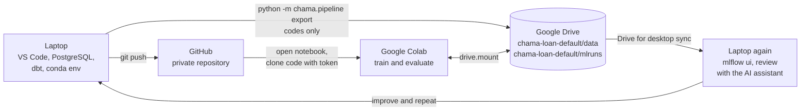
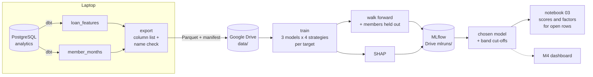
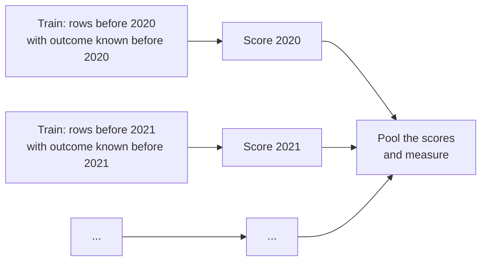

# Milestone 2 report — features and models

*Chama Loan Default Prediction · report date 22 October 2026 · branch `m2-features-models`*

This report describes everything built, tested and decided in Milestone 2
(M2): the working method agreed with the supervisor (laptop, GitHub, Google
Colab, Google Drive), the corrections made to the data, the two prediction
targets, the features, the models and the ways of handling class imbalance
(including the k-means methods), how the models were tested, the results, the
model carried forward, the risk bands, the explanations, the limitations, the
commands to run everything, and what Milestone 3 builds on.

It contains no member names. Member codes appear only where needed to explain
a correction. Detailed references: [decisions.md](decisions.md) (decisions
D-016 to D-023 are new in M2), [data_dictionary.md](data_dictionary.md) (the
two modelling tables), the [CHANGELOG](../CHANGELOG.md), the
[M1 report](milestone_1_report.md) and the three notebooks in
[notebooks/](../notebooks/).

## Contents

1. [Summary](#1-summary)
2. [Objectives and how the plan changed](#2-objectives-and-how-the-plan-changed)
3. [Working method](#3-working-method)
4. [Data protection in M2](#4-data-protection-in-m2)
5. [Correcting the data before modelling](#5-correcting-the-data-before-modelling)
6. [The two targets](#6-the-two-targets)
7. [Features](#7-features)
8. [Architecture](#8-architecture)
9. [Models and imbalance strategies](#9-models-and-imbalance-strategies)
10. [How the models were tested](#10-how-the-models-were-tested)
11. [Experiment tracking with MLflow](#11-experiment-tracking-with-mlflow)
12. [Results](#12-results)
13. [The chosen model](#13-the-chosen-model)
14. [Risk bands](#14-risk-bands)
15. [Explanations](#15-explanations)
16. [Technology stack](#16-technology-stack)
17. [Design decisions](#17-design-decisions)
18. [Testing and quality assurance](#18-testing-and-quality-assurance)
19. [Limitations](#19-limitations)
20. [Running the project](#20-running-the-project)
21. [What is left to close Milestone 2](#21-what-is-left-to-close-milestone-2)
22. [Why this milestone matters](#22-why-this-milestone-matters)
23. [Next: Milestone 3 — MLOps](#23-next-milestone-3--mlops)
24. [Glossary](#24-glossary)
25. [Appendix A: every run of the final batch](#appendix-a-every-run-of-the-final-batch)
26. [Appendix B: sensitivity check](#appendix-b-sensitivity-check)

---

## 1. Summary

| | |
| --- | --- |
| **Goal of M2** | Turn the clean ledger data from M1 into models that give officials a risk score, a risk category and an explanation, tested honestly |
| **Working method** | The supervisor's Sprint II workflow: code on the laptop, versioned on GitHub (now private), trained in Google Colab, data and results on Google Drive, results reviewed locally with an AI assistant (section 3) |
| **Data correction** | Six member codes that were one person under a second spelling were merged in the name review: 18 codes became 12, false "lost track" loans fell from 21 to 7, and the figures again match the M1 report (section 5) |
| **Targets** | **Loan default** (one row per loan; 247 loans with a known outcome, 28 provisional defaults) and, added in M2, an **early warning of missed repayments** (one row per member per meeting while a loan runs; 1,187 rows with a known outcome, 222 events) |
| **Features** | Built in dbt from what was known at the time only (point in time), checked by unit tests: 18 for loan default, 17 for the early warning. Money is used only as ratios |
| **Models compared** | Logistic regression, random forest and XGBoost, each trained four ways: no imbalance correction, class weights, **k-means SMOTE** and **k-means cluster centroids** — 24 runs per training batch |
| **Testing** | Walk forward in time (train on earlier years, test on the next), with members held out as a second check; PR AUC, ROC AUC and Brier score with bootstrap 95% intervals |
| **Tracking** | Every run logged to MLflow on Google Drive: settings, data version, metrics, plots, test scores, SHAP and the fitted model |
| **Chosen model** | **Random forest without imbalance correction** (500 trees, depth 4, at least 20 rows per leaf), for both targets (D-023) |
| **Main result** | The early warning ranks future missed repayments above chance: walk-forward PR AUC **0.323** (95% interval 0.27–0.38) against 0.20 by chance, ROC AUC 0.670. Its risk bands had **12% / 24% / 35%** missed repayments in testing (low / medium / high) |
| **Loan default** | No model ranks future loans reliably (ROC AUC about 0.5). With 28 provisional defaults this is expected; the category should not be shown to officials until the label is agreed with the Chama |
| **k-means** | Both k-means methods were tested on the same tests as every other strategy and not adopted: k-means SMOTE PR AUC 0.305, cluster centroids 0.281, against 0.323 without a correction |
| **Checks** | 95 Python tests; the full dbt build passes (60 checks, 3 known warnings, 0 errors), including 5 dbt unit tests |
| **Decisions** | D-016 to D-023 |

---

## 2. Objectives and how the plan changed

The project's aim is unchanged: a decision-support tool that gives Chama
officials a **risk score, a risk category and an explanation**. It does not
approve or reject loans.

| Milestone | Focus | Status |
| --- | --- | --- |
| M1 | Data pipeline: ingest, anonymise, validate, clean | Done |
| **M2** | **Features and models, experiment tracking, trained in Colab** (this report) | **Done** |
| M3 | MLOps: model registry, monitoring with Evidently, Docker, scheduling | Next |
| M4 | Dashboard for officials (Streamlit) | Planned |
| M5 | Report and defence | Planned |

**M2 objectives** (from section 16 of the M1 report), and what happened:

| Objective | Outcome |
| --- | --- |
| 1. Agree the target with the Chama | Partly. **Overdue = default** is confirmed. Rolled-over and lost-track loans count as defaults provisionally (D-018) |
| 2. Build features from each member's history before the loan | Done, in dbt, with unit tests that prove nothing after the issue month is used (D-018) |
| 3. Train and compare models suited to small data | Done: three models, four imbalance strategies, strong regularisation (D-020) |
| 4. Validate honestly | Done: walk forward in time with outcomes known before each test year, members held out, intervals (D-020) |
| 5. Explain with SHAP and map scores to risk categories | Done: SHAP for every run; risk bands by share of out-of-time scores (D-022) |

**Changes to the plan**, each recorded as a decision:

- **The supervisor's workflow** (Colab and Google Drive) was adopted, with a
  boundary on what data may leave the computer (D-016), and the GitHub
  repository was made private (D-017).
- **MLflow tracking moved from M3 into M2** (D-019), because comparing many
  models needs it from the first run; M3 keeps the registry, serving and
  monitoring.
- **A second target** was added: an early warning of missed repayments
  (D-021). With 28 defaults the loan-default target cannot support a reliable
  model; the early warning has eight times as many events and a label that
  needs no agreement on loan terms.
- **Risk bands are set by share**, not by fixed scores (D-022).

---

## 3. Working method

### 3.1 The Sprint II workflow

The supervisor asked for this cycle: develop on the laptop, commit and push to
GitHub, open notebooks in Google Colab, read data from and save results to
Google Drive, review the synced results locally with an AI assistant, improve
and repeat.



How each box is set up in this project:

| Step | Set-up |
| --- | --- |
| Laptop | `chama` conda environment (Python 3.11) with `pip install -e ".[dev,ml]"`; PostgreSQL in Docker; VS Code with Claude Code as the assistant |
| GitHub | `muriithi-alvin/chama-loan-default`, **private** (D-017); branch `m2-features-models`; the project owner makes every commit |
| Colab | Opens the notebooks from GitHub. The first cell mounts Drive, clones the code using a read-only GitHub token from **Colab Secrets** (`GITHUB_TOKEN`), installs MLflow, SHAP, imbalanced-learn and python-dotenv, and sets `DRIVE_DIR` |
| Drive | `My Drive/chama-loan-default/` with `data/` (the two exported tables and their manifests) and `mlruns/` (MLflow). On the laptop, Drive for desktop syncs it (here as `H:`), set as `DRIVE_DIR` in `.env` |
| Review | `mlflow ui` on the synced runs; notebooks run locally in the `chama` environment as well |

**Colab is not needed for speed.** A training batch of 24 runs takes about
35 minutes on the laptop. Its value is a shared environment the supervisor can
open and rerun. Every notebook runs in both places, so the work never depends
on Colab being available.

**The GitHub token** is fine-grained: this repository only, with exactly two
permissions, **Contents: read-only** and **Metadata: read-only**. Without
Contents, cloning fails with the misleading message "Write access to
repository not granted". The setup cell shows git's own error message with the
token replaced by `***`.

**The Colab VS Code extension** was considered. It runs notebook cells on a
Colab machine from VS Code, but at the time of writing `drive.mount()` and
Colab Secrets were reported as unreliable or unsupported in it, and the
machine cannot see the laptop's files. It does not remove the need for Drive.
The notebooks are run in the browser version of Colab, or locally.

### 3.2 AI-assisted development

As in the workflow's "AI-assisted research" box, the code, tests and analyses
were developed with an AI assistant (Claude Code) working in this repository,
and the project owner verified, decided and committed:

| The assistant | The project owner |
| --- | --- |
| Wrote the dbt models, Python modules, tests and notebooks; ran the pipeline, tests and training; analysed results; proposed decisions with evidence | Reviewed member names against the ledger photos (section 5); decided the default label (overdue = default), the model family (random forest), the use of k-means methods, the Colab/Drive set-up; made every commit and push |
| Worked only with member **codes**, counts and balances; never read names | Kept names on the laptop: the name review was done in their own terminal |

---

## 4. Data protection in M2

M1's rule still holds: **names stop at the anonymisation step** (D-001). M2
adds one controlled exit for data (D-016):

- **Only two tables leave the laptop**: `analytics.loan_features` and
  `analytics.member_months`, written by `python -m chama.pipeline export` as
  Parquet files with a manifest. They hold member codes, loan types, months,
  ratios and features: **no names and no free text**.
- **The export stops and writes nothing** if a table gains a column that is
  not on its approved list (a new column must be approved in code on purpose),
  or if any value contains a word of a member's name (the same check as the
  anonymisation step).
- **Never leave the laptop:** photos, workbooks, the name review files, the
  `raw` and `private` schemas, `.env` and the pseudonym key.
- **Permission.** The officials confirmed on 16 October 2026 that their
  permission covers keeping the codes-only tables on Google Drive.
- **Re-identification risk.** Codes are pseudonymous, not anonymous: with
  about a dozen members, someone who knows the group could recognise a member
  from loan sizes and dates. This is why the repository is private (D-017) and
  why the Drive folder is the owner's own.
- **GitHub** holds code, configuration and notebooks only. Notebook outputs
  can hold codes and scores (the notebooks read only the exported tables), so
  the repository is private. `*.parquet` and `mlruns/` are ignored by git.
- **Models** are saved with cloudpickle and loaded back only by this project,
  from its own Drive folder (D-019).
- **In this report** member codes appear only in section 5, to explain a
  correction.

---

## 5. Correcting the data before modelling

### 5.1 What was found

When M2 started, the database built from the merged M1 code gave **277
loans, 18 member codes and 21 lost-track loans**, not the 263, 13 and 7 in the
M1 report. Lost-track loans count as defaults in the provisional label, so
this mattered.

Looking at codes and balances only, three pairs of codes handed loans to each
other at exactly the same balance, page after page. For example, one member's
loan stood at **82,860** on page 30; on page 31 exactly 82,860 appeared under a
second code and fell to 69,355 by page 33; on page 34, 69,355 was back under
the first code. Each "extra" code appeared **only on pages where its regular
member was missing**, and where both codes appeared on one page they were two
different loans of one person, with the monthly contribution on only one line.
This is one person written under two spellings that the name review had not
linked. M1's decision D-010 had warned of exactly this.

### 5.2 How it was fixed

| Extra code | Merged into | Evidence |
| --- | --- | --- |
| `M-52454300` | `M-96ff59b6` | Missing-member pages 31–33 and 106; balances 82,860 → 69,355 and a 40,000 school-fees loan handed over |
| `M-d3c4f911` | `M-96ff59b6` | Page 31, where the regular member is missing |
| `M-94fd2be9` | `M-0237d98e` | Six handovers 2019–2024 (10,000; 40,000; 70,000; 50,000; 27,000; 40,000) |
| `M-e8335728` | `M-613484c6` | Pages 130–135; 30,000 → 10,000 handed over |
| `M-4c9543cd` | `M-99429b56` | Page 45 (contribution only) |
| `M-58e3c74b` | `M-99429b56` | Page 2; its page-73 line was checked against the photo and assigned by the owner |

The project owner looked up the names behind the codes in their own terminal,
checked the photos, and set the same canonical name for each pair in
`data/interim/aliases_chama_b.csv`; `load-aliases` and `all` rebuilt the
database. Names never left the laptop.

A new **warning test**, `loan_continues_under_another_member`, now lists any
lost-track loan whose balance is picked up by another member's new loan
within three pages. It fell from 15 to **3**; the three left are coincidences
of round amounts (5,000 and 30,000 emergency loans).

### 5.3 After the correction

| | Before | After | M1 report |
| --- | --- | --- | --- |
| Member codes | 18 | **12** | 13 |
| Loans | 277 | **263** | 263 |
| Repaid on time / late | 163 / 68 | **161 / 70** | 161 / 70 |
| Rolled over / overdue / open | 15 / 6 / 4 | **15 / 6 / 4** | 15 / 6 / 4 |
| Lost track | 21 | **7** | 7 |
| Provisional defaults (modelling table) | 42 | **28** | — |

The loan figures now match the M1 report exactly. The M1 report's 13 members
came from an earlier state of the review; the review file had since lost these
merges, and they are now restored.

### 5.4 One more data fix: counting meetings

Page numbers skip **page 51**: the blurred photo p048 was retaken later as
p051 and typed under page 48. Features and labels that count "the next three
meetings" therefore count meetings in order (`meeting_seq`), not by page
number. A dbt unit test includes a page-number gap.

---

## 6. The two targets

### 6.1 Loan default (one row per loan)

**Question:** will this loan default?

| | |
| --- | --- |
| Table | `analytics.loan_features`: one row per loan with a known issue month (251; the 12 loans already running on the first page have no history and are left out) |
| Label | `defaulted` = 1 when the loan's status is in `default_statuses` (`config/pipeline.yaml`) |
| Label rule | **Overdue** (past its due month and unpaid at the end of the records) — **confirmed** as a default by the project owner. **Rolled over** while unpaid (`topped_up`) and **lost track** (stops appearing) — **provisional** until agreed with the Chama (D-018) |
| Known outcomes | 247 loans (4 still open) |
| Defaults | **28** (15 rolled over, 6 overdue, 7 lost track): about 1 loan in 9 |

**Caveats on the label.** All six overdue loans (2023–2025) are normal loans of
250,000–350,000 with no due month written, so they are judged by the 12-month
rule while still being repaid (one was down from 290,000 to 90,000). If the
Chama agreed a longer term for large loans, `loan_term_days` should say so.
Most of the seven lost-track loans are small emergency or school-fees loans
whose repayment was probably not written down; one member stopped appearing in
2020 with 89,640 outstanding. These need the Chama's explanation.

### 6.2 Early warning of missed repayments (one row per member per meeting)

**Question:** will this member miss a repayment in the next three meetings?

| | |
| --- | --- |
| Table | `analytics.member_months`: one row per member per meeting while the member owes on a loan (1,211 rows, 12 members) |
| Label | `missed_ahead` = 1 when a running loan of the member gets **no repayment written** at any of the next `warning_horizon_meetings` (3) meetings |
| Known outcomes | 1,187 rows (the last three meetings of the records cannot be labelled yet) |
| Events | **222** (18.7%): about 1 row in 5 |

Why add it (D-021):

- **Eight times as many events** to learn from (222 against 28).
- **The label needs no agreement on loan terms**: a missed repayment is
  written in the ledger as it happens.
- **It is useful in its own right**: officials see, at every meeting, which
  members are likely to fall behind soon, between loan requests.

How often repayments were missed, by year (rows with a known outcome):

| Year | 2014 | 2015 | 2016 | 2017 | 2018 | 2019 | 2020 | 2021 | 2022 | 2023 | 2024 | 2025 |
| --- | --- | --- | --- | --- | --- | --- | --- | --- | --- | --- | --- | --- |
| Rows | 128 | 113 | 113 | 107 | 104 | 112 | 82 | 79 | 88 | 87 | 84 | 82 |
| Events | 17 | 13 | 17 | 15 | 15 | 14 | 24 | 2 | 24 | 16 | 33 | 29 |
| Rate | 13% | 12% | 15% | 14% | 14% | 12% | 29% | 3% | 27% | 18% | 39% | 35% |

Misses were steady at 12–15% until 2019, then swung (29% in 2020, 3% in
2021) and rose to 35–39% in 2024–2025, as loans grew to 250,000–350,000.

---

## 7. Features

### 7.1 Point in time

Every feature uses **only what was known when the decision would be made**:
for a loan, meetings before its issue month and earlier loans as they stood
then; for the early warning, the current meeting and earlier ones. Both rules
are built in dbt (`transform/models/features/`) and proven by dbt unit tests
on made-up rows that include later data which must not be used.

Each row also records **`outcome_month`**: when its outcome became known
(the month a loan was cleared, the month the loan it was rolled into was
given, the month after it fell due unpaid, three months after its last line
for lost-track loans, or the third meeting ahead for the early warning). The
tests use it so that a model never learns from an outcome nobody knew yet
(section 10).

### 7.2 Loan default features (18)

| Group | Features |
| --- | --- |
| The request | `loan_type` (normal, emergency, school fees), `is_rollover` (an unpaid loan is rolled into this one), `amount_vs_own_max` (amount against the member's largest earlier loan of the type), `amount_vs_chama_median` (against the Chama's median loan of the type in the last 12 months), `outstanding_vs_amount` (debt already owed against the new loan) |
| The member's record | `months_in_records`, `prior_loans`, `prior_repaid`, `prior_repaid_late`, `prior_rolled_over`, `recent_emergency_loans`, `recent_school_fees_loans` |
| Position at issue | `open_loans_at_issue`, `oldest_open_loan_months` |
| Recent behaviour (12 months) | `recent_balance_lines`, `recent_missed_share`, `recent_repayment_ratio`, `recent_contribution_rate` (contributions are written from 2017) |

### 7.3 Early-warning features (17)

| Group | Features |
| --- | --- |
| Loans after the meeting | `open_loans`, `outstanding_vs_chama_median`, `oldest_open_loan_months`, `loan_started_this_meeting`, `has_emergency_loan`, `has_school_fees_loan` |
| The member's record | `months_in_records`, `loans_so_far`, `prior_rolled_over`, `missed_last_3_meetings`, `recent_missed`, `recent_missed_share`, `repayment_ratio_last_3_meetings`, `months_since_last_miss`, `recent_contribution_rate` |
| The Chama | `chama_missed_share` (share of running loans with no repayment at this meeting) |
| Season | `month_of_year` (school fees fall due in January, May and September) |

Simple averages already show the signal: rows followed by a miss had more
misses in the last three meetings (0.50 against 0.18), a higher share of
recent meetings missed (15% against 6%), older open loans (10 against 8
months) and more past roll-overs (1.6 against 0.8).

### 7.4 Money only as ratios

Normal loans grew from about 45,000 (2014) to 250,000–350,000 (2023–2025),
about six-fold. A model trained on earlier years would judge new loans by
amounts it had never seen, and the first SHAP results were led by the raw
amount. Raw `amount` and `outstanding_at_issue` were therefore replaced by
ratios (D-020). On clean labels the walk-forward test showed no loss of
ranking and a slightly better Brier score:

| Feature set (mean of 5 runs) | PR AUC | ROC AUC | Brier |
| --- | --- | --- | --- |
| Raw amount and outstanding debt | 0.203 | 0.634 | 0.192 |
| Without raw amount | 0.205 | 0.632 | 0.178 |
| Ratios only (the one adopted) | 0.200 | 0.631 | 0.178 |

### 7.5 Missing values

Empty is often meaningful: `amount_vs_own_max` is empty for a member's first
loan of a type, `months_since_last_miss` for a member who has never missed,
`recent_contribution_rate` before 2017. The models fill gaps with the training
median and add a 0/1 column saying the value was missing, so "never missed"
can itself be learned.

### 7.6 What is not used

Member codes (the model must judge behaviour, not identity), years (a time
trend does not carry into the future), the outcome columns, free text (never
leaves `raw`, D-008) and attendance (no attendance data was recorded).

---

## 8. Architecture



### 8.1 Code

| Part | Where | What it does |
| --- | --- | --- |
| Features | `transform/models/features/loan_features.sql`, `member_months.sql` (+ `.yml`) | The two modelling tables, their tests and unit tests |
| Export | `src/chama/features/export.py` | Writes both tables to `<DRIVE_DIR>/data` with manifests, after the column and name checks |
| Targets | `src/chama/models/data.py` | A `Target` describes each target: table, label, time column, features, keys |
| Models | `src/chama/models/estimators.py` | Preparation, the three models, the four imbalance strategies, the prior correction |
| Tests | `src/chama/models/evaluate.py` | Walk forward, members held out, metrics with intervals, band cut-offs and band tables |
| Explanations | `src/chama/models/explain.py` | SHAP contributions, importance, top factors per row |
| Plots | `src/chama/models/plots.py` | Precision-recall, calibration, SHAP importance (matplotlib) |
| Training | `src/chama/models/train.py` | Trains every combination per target and logs each run to MLflow |
| Chosen model | `src/chama/models/chosen.py` | Finds the chosen model's latest run; loads the model and its cut-offs |
| Commands | `src/chama/pipeline.py` | `export` and `train` beside the M1 steps |
| Settings | `config/pipeline.yaml` | Label rule, horizon, test years, strategies, band shares, chosen model |
| Notebooks | `notebooks/01_explore_features`, `02_train_and_compare`, `03_explain_risk` | Run in Colab or locally |

### 8.2 Settings

All modelling settings are in `config/pipeline.yaml`, shared first, then one
block per target:

```yaml
default_statuses: [topped_up, overdue, lost_track]   # loan-default label (D-018)
history_months: 12                                   # "recent" look-back
warning_horizon_meetings: 3                          # early-warning label (D-021)
modelling:
  member_folds: 5
  models: [logistic_regression, random_forest, xgboost]
  imbalance: [none, class_weight, kmeans_smote, cluster_centroids]
  bootstrap_samples: 1000
  random_state: 42
  targets:
    loan_default:
      experiment: chama-loan-default
      test_years: [2018, 2019, 2020, 2021, 2022, 2023, 2024]
      min_training_events: 5
      band_shares: {high: 0.20, medium: 0.30}
      chosen: {model: random_forest, imbalance: none}
    missed_repayment:
      experiment: chama-missed-repayment
      test_years: [2016, 2017, 2018, 2019, 2020, 2021, 2022, 2023, 2024, 2025]
      min_training_events: 20
      band_shares: {high: 0.20, medium: 0.30}
      chosen: {model: random_forest, imbalance: none}
```

---

## 9. Models and imbalance strategies

### 9.1 Preparation

Every model shares one preparation step: missing values filled with the
training median plus a missing-value column, skewed ratios log-scaled, all
numbers standardised (needed by k-means and SMOTE, harmless for trees), and
loan type one-hot encoded.

### 9.2 Models

Settings are deliberately cautious for a few hundred loans and a dozen
members.

| Model | Settings | Why |
| --- | --- | --- |
| Logistic regression | C = 0.3 (strong regularisation) | The interpretable baseline |
| Random forest | 500 trees, depth 4, **at least 20 rows per leaf**, square-root features | Robust on small data; leaf size from the sensitivity check (Appendix B) |
| XGBoost | 300 trees, depth 2, learning rate 0.05, subsample 0.8, λ = 5 | Strong on tabular data when regularised |

### 9.3 Imbalance strategies

Defaults are about 1 loan in 9, missed repayments about 1 row in 5. At the
project owner's request, the k-means methods were included. All four
strategies were compared on the same tests:

| Strategy | What it does to the **training** rows |
| --- | --- |
| `none` | Nothing |
| `class_weight` | Each event counts as much as all non-events together |
| `kmeans_smote` | k-means groups the rows; synthetic events are created inside groups where events occur (imbalanced-learn `KMeansSMOTE`) |
| `cluster_centroids` | The non-events are reduced to one **real** row per k-means group, until the classes are equal (`ClusterCentroids`, hard voting) |

Resampling is applied **inside each training fold only**, never to the rows
being scored.

**Prior correction.** Weighting and resampling train a model as if half of all
rows were events, which raises every score. Before the correction this put
every loan in the high band (a Brier score of about 0.35). The scores of these
strategies are therefore moved back to the real share of events (odds
multiplied by share ÷ (1 − share); Saerens et al. 2002, Dal Pozzolo et al.
2015). The order of the scores, and so PR AUC and ROC AUC, is unchanged; the
Brier score and bands become comparable with `none`.

Why test rather than assume: van den Goorbergh et al. (JAMIA 2022, "The harm
of class imbalance corrections for risk prediction models") found that random
over- and undersampling and SMOTE did not improve the ranking of logistic
regression models and made their probabilities overestimate risk. Testing on
this data gives evidence either way.

---

## 10. How the models were tested

### 10.1 Walk forward (the main test)

For each test year, a model is trained **only on rows from before that year
whose outcome was also known before it** (`outcome_month`), then scores that
year's rows. The test years are pooled for the metrics. This copies how the
Chama would use a model: learn from the past, judge what comes next.



Pool sizes:

| | Loan default | Early warning |
| --- | --- | --- |
| Test years | 2018–2024 (loans given after 2024 have had too little time to show a default) | 2016–2025 |
| Test rows | 133 loans | 938 member-meetings |
| Events in the pool | 22 defaults (chance PR AUC 0.165) | 189 misses (chance 0.201) |
| Minimum known events before a test year | 5 | 20 |

Loan-default pool by year, with what each year's model could learn from:

| Test year | 2018 | 2019 | 2020 | 2021 | 2022 | 2023 | 2024 |
| --- | --- | --- | --- | --- | --- | --- | --- |
| Test loans (defaults) | 21 (5) | 24 (5) | 19 (2) | 28 (3) | 14 (1) | 13 (3) | 14 (3) |
| Training loans (defaults) | 91 (5) | 115 (6) | 136 (13) | 156 (16) | 187 (18) | 200 (20) | 212 (21) |

2018 and 2019 train on only 5–6 known defaults, but without them the test
rests on 12 defaults instead of 22.

### 10.2 Members held out (a second check)

Each member's rows are kept together in one of five folds, so every row is
scored by a model that never saw that member. This ignores time, so it reads
as "would this work for a new member", not as the main result.

### 10.3 Metrics

| Metric | What it says | Chance level |
| --- | --- | --- |
| **PR AUC** (average precision) | Are events ranked first? The main metric for rare events | The share of events |
| **ROC AUC** | Does a random event score above a random non-event? | 0.5 |
| **Brier score** | Mean squared gap between score and outcome; lower is better | Giving everyone the average risk: share × (1 − share), about 0.14 (loans) and 0.16 (early warning) |
| **Band rates** | How often each risk band had the event (section 14) | The overall share |

PR AUC and ROC AUC have **bootstrap 95% intervals** (1,000 resamples). A
difference inside the intervals is not treated as a win.

### 10.4 How results moved during M2

| Stage | Data and method | What it showed |
| --- | --- | --- |
| 16 Oct | Loan default only; labels still held the split-member artefacts (42 defaults); test years 2019–2024 | Best PR AUC 0.38 against 0.23 chance; cluster centroids at chance |
| 19 Oct | Names fixed (28 defaults); 12 test defaults | XGBoost + cluster centroids PR AUC 0.52 (interval 0.26–0.77) but Brier 0.36 and every loan in the high band: led to the prior correction and to testing from 2018 (22 defaults) |
| 19 Oct | Prior correction, 2018–2024 | ROC AUC 0.50–0.55 for every model: no reliable ranking of future loans |
| 20 Oct | Money as ratios; early-warning target added | The early warning beats chance (PR AUC 0.31, interval 0.26–0.37) |
| 21 Oct | Risk bands by share; forest leaves ≥ 20 rows | Final batch (section 12) |

The first two stages are not comparable with the final results, because their
labels or tests differed; they are kept in MLflow and in D-020 as the record
of how the method was settled.

---

## 11. Experiment tracking with MLflow

- **One experiment per target**: `chama-loan-default` and
  `chama-missed-repayment`, in `<DRIVE_DIR>/mlruns`.
- **One run per model and strategy.** Each `train` call is a **training
  batch**: its runs share the tag `training_batch`, and notebook 03 and
  `chama.models.chosen` take the latest batch.
- **Each run holds:**

| Kind | Content |
| --- | --- |
| Params | Target, model, strategy, test years, minimum events, member folds, band shares, seed, number of features |
| Tags | Data file hash (MD5), export time, git commit of the export, label rule, history months, warning horizon, training batch |
| Metrics | `forward_*` and `members_*` (PR AUC, ROC AUC and their intervals, Brier, rows, events, event share), band rates, the high-to-low rate ratio, the band cut-offs |
| Plots | Precision-recall and calibration (walk forward), SHAP importance (final model) |
| Tables | Walk-forward scores, members-held-out scores, risk bands, SHAP importance, the feature list |
| Model | The final model (trained on every row with a known outcome) with an input example |

Two MLflow 3 issues were worked around (D-019):

- MLflow 3 keeps **folder tracking** in maintenance mode and refuses it unless
  `MLFLOW_ALLOW_FILE_STORE=true`; the code sets this. Its recommended SQLite
  database is a single file that Colab's Drive mount and Drive for desktop
  would both write, which risks corrupting it; a folder of small files syncs
  safely. M3 can move the runs to a database with `mlflow migrate-filestore`.
- MLflow's default model format (**skops**) refuses the imbalanced-learn and
  XGBoost types, so models are saved with **cloudpickle**.

To browse the runs, see section 20.

---

## 12. Results

All figures are from the **final training batch of 21 October 2026**
(`training_batch` 2026-10-21T13:05:25Z). Appendix A lists all 24 runs.

### 12.1 Early warning (missed repayments)

| Run (walk forward) | PR AUC (95% interval) | ROC AUC | Brier | Members held out: PR AUC / ROC AUC |
| --- | --- | --- | --- | --- |
| **Random forest, no correction** (chosen) | **0.323** (0.271–0.383) | **0.670** | **0.152** | 0.310 / 0.640 |
| Random forest, class weights | 0.324 (0.271–0.383) | 0.668 | 0.155 | 0.306 / 0.622 |
| Random forest, k-means SMOTE | 0.305 (0.253–0.364) | 0.649 | 0.159 | 0.316 / 0.623 |
| Random forest, k-means cluster centroids | 0.281 (0.233–0.340) | 0.592 | 0.162 | 0.226 / 0.544 |
| Logistic regression, no correction | 0.240 (0.203–0.285) | 0.600 | 0.201 | 0.349 / 0.678 |
| XGBoost, no correction | 0.231 (0.197–0.274) | 0.579 | 0.181 | 0.276 / 0.627 |
| *Chance* | *0.201* | *0.5* | *about 0.16* | *0.187 / 0.5* |

- **The random forest ranks future missed repayments above chance:** the
  lower end of its PR AUC interval (0.271) is above chance (0.201). This is
  the first result in the project that clearly beats chance on the forward
  test.
- **Its scores rank well but are not yet reliable probabilities:** its Brier
  score (0.152) is close to giving everyone the average risk (about 0.16).
  This is why the risk bands are set by share (section 14).
- **On members it never saw**, logistic regression did best (ROC AUC 0.678).
  The main use is the same members over time, so the walk-forward test
  decides.
- **XGBoost** did worse than the forest on this data, even with strong
  regularisation.

### 12.2 Loan default

| Run (walk forward) | PR AUC (95% interval) | ROC AUC (95% interval) | Brier | Members held out: PR AUC / ROC AUC |
| --- | --- | --- | --- | --- |
| XGBoost, k-means cluster centroids | 0.269 (0.135–0.462) | 0.520 (0.372–0.681) | 0.140 | 0.190 / 0.667 |
| **Random forest, no correction** (chosen) | **0.228** (0.126–0.415) | **0.535** (0.384–0.691) | **0.143** | 0.213 / 0.632 |
| Random forest, class weights | 0.227 (0.129–0.408) | 0.550 (0.394–0.703) | 0.145 | 0.223 / 0.645 |
| Random forest, k-means SMOTE | 0.202 (0.116–0.360) | 0.530 (0.386–0.677) | 0.147 | 0.198 / 0.650 |
| Logistic regression, no correction | 0.185 (0.107–0.335) | 0.506 (0.386–0.642) | 0.199 | 0.143 / 0.554 |
| *Chance* | *0.165* | *0.5* | *about 0.14* | *0.113 / 0.5* |

- **No model ranks future loans reliably.** Every ROC AUC interval includes
  0.5, and every PR AUC interval includes chance.
- **With members held out** the trees reach ROC AUC 0.63–0.67, so some
  signal exists across members, but it does not carry forward in time.
- **Why:** 22 test defaults and 5–21 training defaults per year are too few;
  the label mixes different things (roll-overs, overdue large loans judged by
  the 12-month rule, unrecorded repayments); and the Chama's practice changed
  over the years (loan sizes, terms, interest).

### 12.3 The imbalance verdict, including k-means

| Strategy (random forest) | Early warning PR AUC | Loan default PR AUC | Verdict |
| --- | --- | --- | --- |
| None | **0.323** | **0.228** | Adopted: as good as the best, and the simplest |
| Class weights | 0.324 | 0.227 | Tied; adds weights and a prior correction for no gain |
| k-means SMOTE | 0.305 | 0.202 | Not adopted: slightly lower ranking and weaker bands (high band 26% against 35%) |
| k-means cluster centroids | 0.281 | 0.166 | Not adopted: discards real repaid rows; lower ranking on both targets |

On these data **no imbalance correction is needed** for the random forest.
The k-means methods were tested fairly — same tests, resampling inside the
training folds only, scores moved back to the real share of events — and the
evidence did not support them. This is consistent with the study cited in
section 9.3.

---

## 13. The chosen model

**Random forest without imbalance correction, for both targets** (D-023): 500
trees, depth 4, at least 20 rows per leaf, square-root features.

| Reason | Evidence |
| --- | --- |
| Best ranking on the early warning | PR AUC 0.323, tied with class weights (0.324) and above every other model |
| Equal or better on every other measure than with class weights | ROC AUC 0.670, Brier 0.152, members held out 0.640, band separation 35% / 12% |
| Simplest | No weights, no resampling, no prior correction |
| Robust to its settings | Every depth and leaf size tested lay within each other's intervals (Appendix B) |
| Same choice for loan default | No model or strategy is reliable there; one model design keeps the system simple |

**Sensitivity check.** The forest was tested walking forward at depths 3, 4, 6
and 8 with at least 5, 10 or 20 rows per leaf. Leaves of at least 20 rows did
a little better on both targets at every depth (early warning PR AUC
0.32–0.33 against 0.27–0.32; Brier 0.155 against up to 0.168), so the forest
uses 20. The setting was chosen on the same test, so part of that small gain
may be luck; the conclusions do not depend on it.

**Where it is used.** `chosen` in `config/pipeline.yaml` names it;
`chama.models.chosen.chosen_model(target)` loads its run from the latest
batch, the fitted model and the band cut-offs. Notebook 03 uses it now and
the M4 dashboard will. Every new training batch updates it automatically.

---

## 14. Risk bands

### 14.1 Method (D-022)

The first bands were fixed score cut-offs (for example 0.20 and 0.40 for the
early warning). They failed: the best early-warning model at the time had
compressed scores (95% below 0.27), so the high band held 3 of 938 test rows.

Bands are now set **by share**: the top 20% of scores are **high**, the next
30% **medium**, the bottom 50% **low** (`band_shares` per target). Each run
turns the shares into score cut-offs **from its own walk-forward scores**, so
the cut-offs are tested out of time; it logs them to MLflow with a band table
giving each band's event rate and a bootstrap 95% interval. Rows still open
are scored with the chosen run's cut-offs.

**Officials should see the band and what it meant in testing, not the raw
score**, because the scores rank well but are not reliable probabilities.

### 14.2 Early warning — the chosen model's bands

Score cut-offs: medium from 0.202, high from 0.277.

| Band | Test rows | Missed within 3 meetings | 95% interval | Share of all misses |
| --- | --- | --- | --- | --- |
| Low (bottom 50%) | 469 | **11.9%** (about 1 in 8) | 9.2–14.9% | 30% |
| Medium (next 30%) | 281 | **23.8%** (about 1 in 4) | 18.9–28.8% | 35% |
| High (top 20%) | 188 | **35.1%** (about 1 in 3) | 28.2–42.0% | 35% |

The high band had a missed repayment almost **three times as often** as the
low band, with intervals that do not overlap. In words an official can use:
*"In testing, about 1 in 3 high-risk members missed a payment within three
meetings, against about 1 in 8 low-risk members."*

### 14.3 Loan default — not meaningful yet

| Band | Test loans | Defaulted | 95% interval |
| --- | --- | --- | --- |
| Low | 66 | 15.2% | 7.6–24.2% |
| Medium | 40 | 10.0% | 2.5–20.0% |
| High | 27 | 29.6% | 14.8–48.1% |

The rates are out of order and the intervals overlap. The loan-default
category should not be presented to officials as meaningful until the label
is agreed with the Chama and there are more defaults.

### 14.4 The latest meeting

At the latest meeting in the records (April 2026), **5 of the 8 members owing
were in the high band**, not about 20%. Misses really have been more common
recently (35–39% of member-meetings in 2024–2025), and the final model,
trained on every year, scores recent members higher than the earlier
walk-forward models whose scores set the cut-offs. The bands still rank
members correctly, but the number flagged will vary with the period. If the
Chama prefers a fixed number flagged at each meeting, the dashboard can rank
within each meeting instead (section 21).

---

## 15. Explanations

SHAP shows, for every scored row, how much each feature pushed the score up or
down. Each run logs the mean absolute SHAP value per feature; notebook 03 shows
the three strongest factors for each open row.

**Early warning — strongest factors (chosen model, mean |SHAP|):**

| Rank | Feature | Meaning |
| --- | --- | --- |
| 1 | `months_since_last_miss` | How recently the member last missed a repayment |
| 2 | `missingindicator_months_since_last_miss` | Whether the member has ever missed one |
| 3 | `recent_missed_share` | Share of the last 12 months' meetings with a missed repayment |
| 4 | `recent_missed` | Number of those meetings |
| 5 | `months_in_records` | Length of membership in the records |
| 6 | `repayment_ratio_last_3_meetings` | Recent repayments against the balance |
| 7 | `loans_so_far` | Number of loans taken |
| 8 | `prior_rolled_over` | Past loans rolled into bigger ones |

Recent repayment behaviour dominates, which matches how officials already
think. Membership length and number of loans also rise with time, as misses
did, so part of their weight may reflect the period rather than the member;
monitoring in M3 should watch this.

**Loan default — strongest factors (chosen model):** the amount against the
member's largest earlier loan of the type, the loan being a normal loan, debt
already owed against the new loan, the number of earlier loans, earlier loans
repaid late, recent meetings with a balance, earlier loans repaid and the
amount against the Chama's median. With no reliable ranking these are
descriptive only.

**Example (one open loan, the XGBoost run of 20 October):** "score 0.40, high; factors: number
of earlier loans (raises risk), debt owed against the new loan (raises risk),
recent meetings with a balance (lowers risk)". The M4 dashboard will phrase
these in plain words.

---

## 16. Technology stack

M1's stack (PostgreSQL in Docker, dbt, click, pandas, pytest, ruff) plus:

| Tool | Version | Role in M2 |
| --- | --- | --- |
| scikit-learn | 1.9 | Logistic regression, random forest, preparation, metrics, grouped folds |
| imbalanced-learn | 0.14 | Pipelines with resampling; `KMeansSMOTE`, `ClusterCentroids` |
| XGBoost | 3.2 | Gradient-boosted trees |
| SHAP | 0.51 | Explanations (tree and linear explainers) |
| MLflow | 3.17 | Experiment tracking on Drive (folder store), model logging |
| pyarrow | — | Parquet export |
| matplotlib | — | Plots |
| Jupyter / nbconvert | — | Notebooks; run end to end for checking |
| Google Colab | — | Training environment shared with the supervisor |
| Google Drive (+ Drive for desktop) | — | Exported data and MLflow runs |

The modelling libraries are the `ml` extra: `pip install -e ".[dev,ml]"`.

**MLOps Zoomcamp alignment.** The project follows the DataTalksClub MLOps
Zoomcamp: experiment tracking with MLflow (module 2) is done in M2; model
registry, orchestration, deployment, monitoring with Evidently and best
practices (CI) follow in M3.

---

## 17. Design decisions

| ID | Decision | Why | Where |
| --- | --- | --- | --- |
| D-016 | Train in Colab; only the codes-only modelling tables go to Google Drive | Supervisor's workflow; D-001's promise kept by an export with a column list and a name check | `export.py`, `DRIVE_DIR` |
| D-017 | Private GitHub repository | Colab saves notebooks with outputs straight to GitHub | GitHub settings |
| D-018 | Point-in-time features and a provisional label, built in dbt | Tested, rebuilt with the data, reusable by the dashboard; label rule in one config line | `loan_features.sql`, `default_statuses` |
| D-019 | MLflow tracking from M2 | Comparing many runs needs it; folder store on Drive; cloudpickle models | `train.py` |
| D-020 | Walk-forward testing; imbalance strategies compared, not assumed; money as ratios | Small, time-ordered data; avoids learning from the future or from unknown outcomes | `evaluate.py`, `estimators.py` |
| D-021 | A second target: early warning of missed repayments | Eight times as many events; no label agreement needed | `member_months.sql` |
| D-022 | Risk bands by share of out-of-time scores | Scores rank but are compressed; fixed cut-offs left bands empty | `band_cutoffs`, `band_shares` |
| D-023 | Chosen model: random forest without imbalance correction | Best or tied best, simplest, robust to its settings | `chosen.py`, `chosen` |

Full context, alternatives and consequences: [decisions.md](decisions.md).

---

## 18. Testing and quality assurance

| Layer | Tests | What they cover |
| --- | --- | --- |
| Python (pytest) | **95** | M1's 45, plus: export column list, name check, manifest, both tables (7); every target × model × strategy gives scores in [0, 1] (24); prior correction keeps the order and restores the share (3); walk forward never learns from later rows or unknown outcomes, skips thin years, scores each row once; members held out never in their own training fold; metrics; band cut-offs by share and band tables with intervals; SHAP shape and top factors; ratios replace raw amounts; settings per target (14 more); finding the chosen run in the latest batch (2) |
| dbt data tests | Part of the full build | Unique ids, required values, accepted labels, `outcome_month` present for every training row, plus M1's tests and the new warning test for loans continued under another member |
| dbt unit tests | **5** | M1's three, plus `loan_features` (nothing after the issue month is used; before-records loans counted as earlier loans) and `member_months` (features look back, the label looks ahead, a page-number gap, a label unknown near the end of the records) |
| Notebooks | 3 | Each run end to end with `jupyter nbconvert --execute` (notebook 02 against a scratch copy of the data, so no test runs reached Drive) |
| Seeds | — | The leading loan-default runs repeated with three random seeds (19 October) gave stable results, for example XGBoost with cluster centroids 0.31–0.33 |
| Linting | ruff | Clean |

Last full dbt build: **60 passed, 3 warnings, 0 errors**. The warnings are
known ledger inconsistencies (2 implausible balances, 6 balances carried with
more than a 2% difference) and the 3 round-amount coincidences of section 5.

---

## 19. Limitations

- **Small data.** One Chama, 12 members, 263 loans, 28 provisional defaults,
  1,187 labelled member-meetings. Intervals are wide; differences of a few
  points are not meaningful.
- **The loan-default label is provisional.** Roll-overs and lost-track loans
  count as defaults until the Chama agrees; most lost-track loans are probably
  unrecorded repayments, and the overdue loans are judged by the 12-month rule
  while still being repaid.
- **Loan default is not predictable yet** over time (ROC AUC about 0.5).
- **Scores are not reliable probabilities.** They rank; the bands carry the
  meaning. Calibration may improve with more data.
- **Practice changed over time.** Miss rates jumped in 2020, fell in 2021 and
  rose to 35–39% in 2024–2025. Models trained on the past may lag; the share
  flagged high varies with the period (section 14.4).
- **Features that grow with time** (membership length, number of loans) may
  partly stand for the period rather than the member.
- **The early-warning label** counts written lines with no repayment; meetings
  a member did not appear at are not counted, and interest-only payments count
  as payments.
- **Selection on the test.** The leaf size and the chosen strategy were picked
  using the walk-forward test; the gains were small, so the effect is small,
  but it is not zero.
- **Transcription accuracy** is still unmeasured (M1 issue #7).
- **Colab VS Code extension** not usable for this workflow at the time of
  writing (section 3.1).

---

## 20. Running the project

All commands run in PowerShell from the project folder, inside the `chama`
conda environment. M1's commands (section 13 of the M1 report) still apply.

### First-time setup for M2

```powershell
conda activate chama
pip install -e ".[dev,ml]"                  # adds scikit-learn, imbalanced-learn, XGBoost, SHAP, MLflow
# Install Google Drive for desktop; create My Drive/chama-loan-default; make it available offline
# In .env (use the letter Drive for desktop shows):
#   DRIVE_DIR="H:/My Drive/chama-loan-default"
python -c "from chama.config import drive_dir, export_dir, mlflow_dir; print(drive_dir(), export_dir(), mlflow_dir())"
```

### Each round

```powershell
docker compose up -d
python -m chama.pipeline all               # rebuild the database, both modelling tables and all checks
python -m chama.pipeline export            # codes-only tables -> <DRIVE_DIR>/data
python -m chama.pipeline train             # both targets, 12 runs each, logged to <DRIVE_DIR>/mlruns
python -m chama.pipeline train --target missed_repayment --model random_forest --imbalance none
```

### Comparing runs

```powershell
$env:MLFLOW_ALLOW_FILE_STORE = "true"
mlflow ui --backend-store-uri "file:///H:/My%20Drive/chama-loan-default/mlruns"
# open http://127.0.0.1:5000, choose an experiment, tick runs, press Compare
```

### The chosen model in Python

```python
from chama.models.chosen import chosen_model
run, model, cutoffs = chosen_model("missed_repayment")   # latest batch, fitted model, band cut-offs
```

### Notebooks

| Notebook | What it does |
| --- | --- |
| `01_explore_features` | Both tables: events by year, features by outcome, missing values |
| `02_train_and_compare` | For `TARGET`: 3 models × 4 strategies, both tests, MLflow logging, the best run's bands and plots |
| `03_explain_risk` | For `TARGET`: the chosen model's band table, SHAP importance, scores, bands and top factors for open rows |

**In Colab** (once): create the fine-grained GitHub token (this repository,
Contents and Metadata read-only), add it as the secret `GITHUB_TOKEN` with
notebook access on. Then File → Open notebook → GitHub → branch
`m2-features-models` (`main` after the merge) and run the first cell. Set
`TARGET = "missed_repayment"` at the top of notebooks 02 and 03 for the early
warning.

### Tests and checks

```powershell
pytest
ruff check src tests
python -m chama.pipeline dbt build
```

### Git: closing the milestone

```powershell
git switch m2-features-models
git pull --no-edit origin main
pytest
git status
git add docs/milestone_2_report.md README.md CHANGELOG.md
git commit -m "M2: milestone 2 report"
git push

git switch main
git pull
git merge --no-ff m2-features-models `
  -m "M2: features, models, experiment tracking and the chosen models" `
  -m "Problem: M1 produced clean, anonymised ledger data but nothing to judge a loan request or a member's repayment risk, and the supervisor's Colab and Google Drive workflow was not in place." `
  -m "Remedy: point-in-time features in dbt for two targets (loan default with a provisional label; a missed repayment in the next 3 meetings); a codes-only export to Google Drive; logistic regression, random forest and XGBoost with four imbalance strategies including k-means SMOTE and cluster centroids, tested walking forward in time and with members held out; MLflow tracking; risk bands by share; SHAP explanations; a random forest without imbalance correction carried forward (D-016 to D-023). Details in docs/milestone_2_report.md."
git push
git switch m2-features-models
```

---

## 21. What is left to close Milestone 2

| Item | Status (22 October 2026) |
| --- | --- |
| Features, models, tests, MLflow, bands, explanations | **Done** |
| Name review correction | **Done** (section 5) |
| Merge into `main` | **Ready** (section 20) |
| Supervisor access | **To do.** Add the supervisor as a collaborator on the private repository so they can open the notebooks in Colab |
| A training run from Colab | **To do.** Run notebook 02 in Colab once, so the supervisor's workflow is shown end to end |
| Confirm with the Chama | **To do.** (1) Do rolled-over and lost-track loans count as defaults? (2) The agreed term of large loans. (3) What happened to the seven lost-track loans. (4) How many members officials can follow up each meeting (band shares, or a fixed number per meeting) |
| Transcription check against the paper (#7) | **Still open** from M1 |

---

## 22. Why this milestone matters

- **There is a working early warning.** On data it had not seen, the model
  sorts members so that the high band misses repayments three times as often
  as the low band. That is useful to officials today.
- **The results are honest.** Walk-forward testing with outcomes known before
  each test year, members held out, intervals and a prior correction mean the
  numbers are what the Chama could expect, not an optimistic random split.
  Where the data cannot support a model (loan default), the report says so.
- **The k-means question is answered with evidence**, not assumption.
- **Everything is traceable.** Every run records the data file's hash, the
  export's git commit and the label rule; every decision is written down.
- **Privacy held.** Names never left the laptop; the only data on Drive and
  GitHub is codes-only and checked on every export.
- **The workflow works** the way the supervisor asked: laptop, private GitHub,
  Colab, Drive, review, repeat.

---

## 23. Next: Milestone 3 — MLOps

Following the MLOps Zoomcamp:

1. **Model registry.** Register the chosen models; move the tracking store
   from folders to a database (the project's PostgreSQL) with
   `mlflow migrate-filestore`.
2. **Batch scoring.** After each export, score the members owing at the
   latest meeting with the chosen early-warning model and store the scores,
   bands and top factors (codes only) for the dashboard.
3. **Monitoring with Evidently.** Watch feature drift and the miss rate by
   period; the jump in misses in 2024–2025 shows why this matters. Alert when
   a band's observed rate drifts from its tested rate.
4. **Docker.** A container for training and scoring, beside the database.
5. **Scheduling** (possibly Kestra, D-011): export, train and score after each
   batch of new ledger pages.
6. **Best practices.** GitHub Actions running ruff and pytest on every push.

M4 then builds the officials' dashboard on the chosen early-warning model:
each member's band, what the band meant in testing, and the top factors in
plain words; the loan-default category stays hidden until the label is agreed.

---

## 24. Glossary

| Term | Meaning |
| --- | --- |
| Target | What a model predicts: loan default, or a missed repayment in the next 3 meetings |
| Event | A row where the target happened (a default, a miss) |
| Point in time | Using only what was known at the moment of the decision |
| `outcome_month` | When a row's outcome became known; used so a model never learns from outcomes nobody knew yet |
| Walk forward | Train on earlier years, test on the next year, repeat, pool the results |
| Members held out | Score each member with a model that never saw them |
| PR AUC | How well events are ranked first; chance equals the share of events |
| ROC AUC | Chance that a random event scores above a random non-event; 0.5 is chance |
| Brier score | Mean squared gap between scores and outcomes; lower is better |
| Bootstrap interval | A 95% range from re-sampling the test rows 1,000 times |
| Class weights | Counting each event more heavily in training |
| SMOTE | Creating synthetic events between real ones |
| k-means SMOTE | SMOTE inside the k-means groups where events occur |
| Cluster centroids | Undersampling: keeping one real non-event per k-means group |
| Prior correction | Moving scores of a model trained on balanced data back to the real share of events |
| Risk band | Low / medium / high from the score, set by share (bottom 50%, next 30%, top 20%) |
| SHAP | How much each feature pushed a score up or down |
| Training batch | All runs of one `train` call, tagged together in MLflow |
| Chosen model | The model carried forward per target (`chosen` in the config) |
| `DRIVE_DIR` | The project folder on Google Drive, set in `.env` |

---

## Appendix A: every run of the final batch

Training batch 2026-10-21T13:05:25Z. Walk-forward PR AUC with its 95%
interval, ROC AUC, Brier score, members-held-out PR AUC and ROC AUC, and the
event rate in the high and low bands.

**Early warning** (938 test rows, 189 misses, chance PR AUC 0.201):

| Run | PR AUC | Interval | ROC AUC | Brier | Members PR AUC | Members ROC AUC | High band | Low band |
| --- | --- | --- | --- | --- | --- | --- | --- | --- |
| random_forest + class_weight | 0.324 | 0.271–0.383 | 0.668 | 0.155 | 0.306 | 0.622 | 0.330 | 0.117 |
| **random_forest + none** | **0.323** | 0.271–0.383 | 0.670 | 0.152 | 0.310 | 0.640 | 0.351 | 0.119 |
| random_forest + kmeans_smote | 0.305 | 0.253–0.364 | 0.649 | 0.159 | 0.316 | 0.623 | 0.255 | 0.126 |
| random_forest + cluster_centroids | 0.281 | 0.233–0.340 | 0.592 | 0.162 | 0.226 | 0.544 | 0.324 | 0.162 |
| logistic_regression + kmeans_smote | 0.246 | 0.209–0.288 | 0.617 | 0.219 | 0.324 | 0.666 | 0.255 | 0.128 |
| xgboost + kmeans_smote | 0.242 | 0.206–0.289 | 0.588 | 0.186 | 0.288 | 0.623 | 0.266 | 0.166 |
| logistic_regression + none | 0.240 | 0.203–0.285 | 0.600 | 0.201 | 0.349 | 0.678 | 0.255 | 0.151 |
| logistic_regression + class_weight | 0.239 | 0.203–0.284 | 0.599 | 0.212 | 0.320 | 0.677 | 0.250 | 0.143 |
| xgboost + class_weight | 0.232 | 0.198–0.275 | 0.584 | 0.186 | 0.290 | 0.633 | 0.234 | 0.173 |
| xgboost + none | 0.231 | 0.197–0.274 | 0.579 | 0.181 | 0.276 | 0.627 | 0.266 | 0.168 |
| logistic_regression + cluster_centroids | 0.230 | 0.193–0.271 | 0.577 | 0.192 | 0.274 | 0.629 | 0.239 | 0.168 |
| xgboost + cluster_centroids | 0.226 | 0.190–0.271 | 0.551 | 0.178 | 0.221 | 0.552 | 0.255 | 0.181 |

**Loan default** (133 test loans, 22 defaults, chance PR AUC 0.165):

| Run | PR AUC | Interval | ROC AUC | Brier | Members PR AUC | Members ROC AUC | High band | Low band |
| --- | --- | --- | --- | --- | --- | --- | --- | --- |
| xgboost + cluster_centroids | 0.269 | 0.135–0.462 | 0.520 | 0.140 | 0.190 | 0.667 | 0.259 | 0.175 |
| **random_forest + none** | **0.228** | 0.126–0.415 | 0.535 | 0.143 | 0.213 | 0.632 | 0.296 | 0.152 |
| random_forest + class_weight | 0.227 | 0.129–0.408 | 0.550 | 0.145 | 0.223 | 0.645 | 0.296 | 0.152 |
| random_forest + kmeans_smote | 0.202 | 0.116–0.360 | 0.530 | 0.147 | 0.198 | 0.650 | 0.222 | 0.152 |
| logistic_regression + cluster_centroids | 0.188 | 0.109–0.340 | 0.508 | 0.206 | 0.124 | 0.522 | 0.185 | 0.167 |
| logistic_regression + none | 0.185 | 0.107–0.335 | 0.506 | 0.199 | 0.143 | 0.554 | 0.148 | 0.136 |
| xgboost + class_weight | 0.181 | 0.110–0.316 | 0.505 | 0.165 | 0.230 | 0.614 | 0.148 | 0.167 |
| xgboost + none | 0.180 | 0.112–0.300 | 0.520 | 0.164 | 0.257 | 0.650 | 0.148 | 0.167 |
| xgboost + kmeans_smote | 0.179 | 0.110–0.297 | 0.521 | 0.169 | 0.191 | 0.599 | 0.222 | 0.121 |
| logistic_regression + class_weight | 0.179 | 0.104–0.325 | 0.489 | 0.236 | 0.137 | 0.516 | 0.111 | 0.152 |
| logistic_regression + kmeans_smote | 0.174 | 0.101–0.318 | 0.475 | 0.276 | 0.126 | 0.497 | 0.111 | 0.167 |
| random_forest + cluster_centroids | 0.166 | 0.096–0.281 | 0.460 | 0.147 | 0.094 | 0.338 | 0.146 | 0.188 |

The top loan-default run (XGBoost with cluster centroids) is not preferred:
its ROC AUC (0.520) and every interval include chance, and its PR AUC fell
from 0.36 to 0.27 when raw amounts were replaced by ratios, so part of its
earlier lead came from the drifting amounts.

---

## Appendix B: sensitivity check

Random forest with class weights, walk forward, 500 trees. PR AUC (95%
interval), ROC AUC, Brier score, and how many times more often the high band
had the event than the low band.

**Early warning:**

| Depth | Min rows per leaf | PR AUC | Interval | ROC AUC | Brier | High ÷ low |
| --- | --- | --- | --- | --- | --- | --- |
| 3 | 5 | 0.317 | 0.264–0.377 | 0.658 | 0.158 | 2.74 |
| 3 | 10 | 0.315 | 0.263–0.375 | 0.660 | 0.157 | 2.71 |
| 3 | 20 | 0.332 | 0.277–0.394 | 0.670 | 0.155 | 2.77 |
| 4 | 5 | 0.308 | 0.256–0.370 | 0.653 | 0.160 | 2.77 |
| 4 | 10 | 0.308 | 0.259–0.365 | 0.661 | 0.158 | 2.79 |
| **4** | **20** | **0.324** | 0.272–0.387 | 0.668 | 0.155 | 2.82 |
| 6 | 5 | 0.284 | 0.236–0.341 | 0.635 | 0.165 | 2.11 |
| 6 | 10 | 0.292 | 0.243–0.353 | 0.651 | 0.161 | 2.49 |
| 6 | 20 | 0.325 | 0.272–0.388 | 0.669 | 0.155 | 2.92 |
| 8 | 5 | 0.269 | 0.226–0.326 | 0.626 | 0.168 | 1.89 |
| 8 | 10 | 0.294 | 0.244–0.354 | 0.648 | 0.161 | 2.41 |
| 8 | 20 | 0.325 | 0.271–0.386 | 0.668 | 0.155 | 2.92 |

**Loan default:**

| Depth | Min rows per leaf | PR AUC | Interval | ROC AUC | Brier |
| --- | --- | --- | --- | --- | --- |
| 3 | 5 | 0.209 | 0.130–0.357 | 0.538 | 0.149 |
| 3 | 10 | 0.198 | 0.123–0.337 | 0.532 | 0.147 |
| 3 | 20 | 0.227 | 0.143–0.407 | 0.550 | 0.145 |
| 4 | 5 | 0.196 | 0.124–0.332 | 0.527 | 0.151 |
| 4 | 10 | 0.195 | 0.122–0.332 | 0.527 | 0.148 |
| **4** | **20** | **0.227** | 0.141–0.407 | 0.550 | 0.145 |
| 6 | 5 | 0.186 | 0.117–0.317 | 0.515 | 0.152 |
| 6 | 10 | 0.193 | 0.121–0.327 | 0.525 | 0.148 |
| 6 | 20 | 0.227 | 0.141–0.407 | 0.550 | 0.145 |
| 8 | 5 | 0.184 | 0.117–0.313 | 0.512 | 0.153 |
| 8 | 10 | 0.193 | 0.121–0.327 | 0.525 | 0.148 |
| 8 | 20 | 0.227 | 0.141–0.407 | 0.550 | 0.145 |

Deep trees with small leaves overfit (early warning PR AUC 0.269 at depth 8
with 5-row leaves); 20-row leaves give the same result at every depth, which
is what a regularised forest on a small dataset should do.
